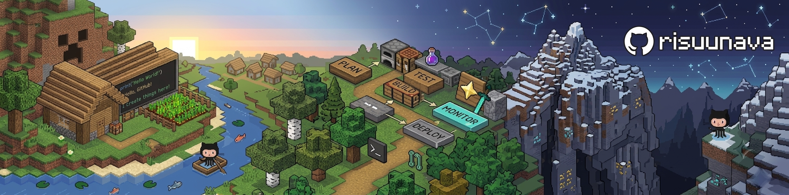

# Muhammad Lazuardi Al-Farisi

Full Stack Software Engineer, Tech Enthusiast

[GitHub](https://github.com/risuunava)  |  [Portfolio](https://portofolio-risu.vercel.app/)  |  [Google Skills](https://www.skills.google/public_profiles/6a6ee609-c84c-47ab-a562-ec7f58fb4490)

## About

Full Stack Software Engineer with expertise in building scalable web applications, desktop tools, and IoT solutions. Specialized in system architecture, machine learning integration, and innovative problem-solving.

## Tech Stack

| Category | Technologies |
|:---|:---|
| Web | PHP, Laravel, JavaScript, TypeScript, React, Next.js, Tailwind CSS |
| Mobile | Flutter, Dart, Capacitor |
| Desktop | C#, WPF, .NET 8, Python (Tkinter) |
| Backend and Database | MySQL, PostgreSQL, Supabase, Firebase, Google Cloud |
| ML and Security | Python, NLP, scikit-learn, LLM security |
| IoT | Arduino, ESP8266, ESP32 |
| Tools | Git, Docker, Postman, Vercel |

## Featured Projects

| Project | Description | Tech | Status | Links |
|:---|:---|:---|:---|:---|
| **Notchi** | Native notch overlay for Windows 10/11, inspired by the macOS notch and Dynamic Island. Compact when idle, expands on hover with media controls, system stats (CPU, RAM, disk, battery), notes, and a file drop shelf. No Electron, idle memory under 100 MB. | C#, WPF, .NET 8 | v1.0.1 stable (Oct 2026), Apache-2.0 | [Repository](https://github.com/risuunava/Notchi) |
| **Attendexa** | Web attendance platform with GPS location check, camera photo verification, and a gamified XP system with streaks and a monthly leaderboard to encourage employee discipline. Neo-Brutalist UI. | React 19, TypeScript, Vite, Tailwind CSS, Supabase | Live | [Repository](https://github.com/risuunava/attendexa) / [Live Demo](https://attendexa-mauve.vercel.app) |
| **Ayumi** (my-ayumi) | Indonesian-language AI voice assistant for Windows. Always listening in the background via a wake word ("Ayumi"), executes one-step voice commands (Wikipedia, open sites, YouTube control, time/date), auto-starts with Windows, and has a dark-mode GUI with real-time logs. | Python, Tkinter, SpeechRecognition, pyttsx3 | Active development | [Repository](https://github.com/risuunava/my-ayumi) |

More projects are available on my [GitHub profile](https://github.com/risuunava?tab=repositories).

## Competencies

| Area | Focus |
|:---|:---|
| Backend Development | REST APIs, database optimization, Laravel ecosystem |
| Full Stack Integration | React, Next.js, and Vue with backend systems, Supabase |
| Desktop Applications | Native Windows apps with C# and WPF, Python desktop tooling |
| Machine Learning | NLP, sentiment analysis, data processing and classification |
| System Architecture | Scalable design patterns, microservices, API development |
| IoT Systems | Embedded systems, hardware integration, real-time processing |

## Education

Universitas Sebelas April
Computer Science / Informatics
Sumedang, West Java, Indonesia

## Connect

Open for collaboration, freelance projects, and full-time opportunities.

[GitHub](https://github.com/risuunava)  |  [Email](mailto:risuunava@gmail.com)  |  [LinkedIn](https://www.linkedin.com/in/muhammad-lazuardi-al-farisi-63478940b)
